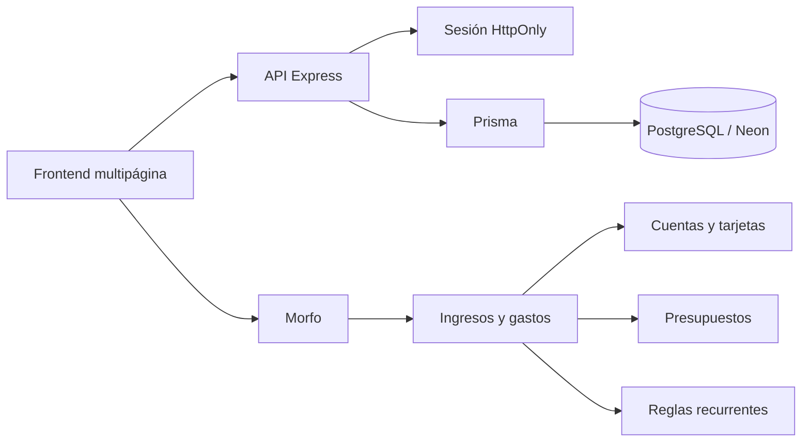

# Arquitectura funcional de Morfo Hub

Morfo Hub lleva las finanzas de la agencia.

## Alcance

### Morfo

- Flujo de efectivo de la agencia.
- Clientes, cotizaciones, cobros y gastos.
- Cuentas por cobrar y lectura comercial.

## Flujo de datos

## Reglas del dominio

- Un movimiento puede asociarse a una cuenta o tarjeta.
- Los ingresos pendientes no aumentan el saldo hasta recibirse.
- Una regla recurrente es una expectativa, no un movimiento realizado.
- El día de corte y el día de pago de una tarjeta son campos distintos.
- Los registros heredados sin espacio explícito se consideran Morfo.
